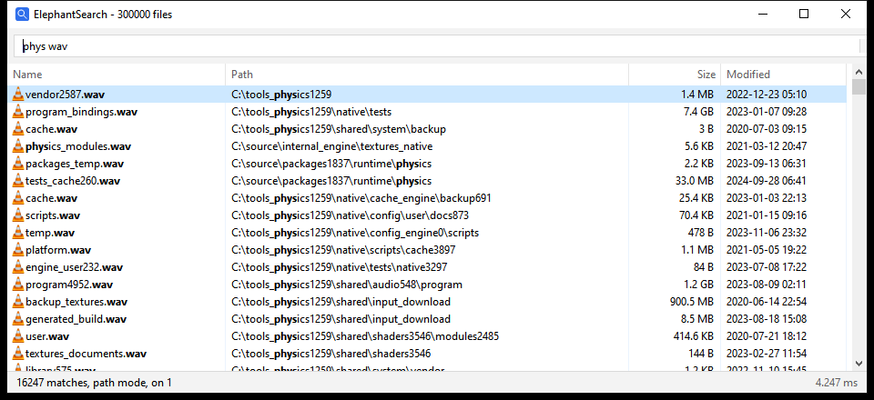

# ElephantSearch

Instant filename search for Windows.

## Description

ElephantSearch reads the NTFS master file table directly instead of walking directories. It indexes 3 million files in about 10 seconds, and every search after that takes under 20 milliseconds.



## Features

* Results that follow every keystroke
* Fuzzy terms, so `srcmainzg` finds `src\main.zig`
* Exact, wildcard and full path terms
* A window with Explorer's icons, sortable columns and Explorer's own right click menu
* The same search in a terminal, or once from a script
* "Search with ElephantSearch" in Explorer's right click menu for folders and drives
* A saved index that catches up on what changed since the last run
* A background service, so searching needs no administrator rights

## Install

Download the zip from the [releases page](https://github.com/Apostolique/ElephantSearch/releases) and unzip it anywhere. Keep the three programs in the same folder.

Then install the background service, so you never have to run it as administrator:

```
elephant --install-service
```

That asks for administrator rights once. Open `elephant-gui.exe` and start typing.

It runs on 64-bit Windows 10 and 11. The programs aren't signed yet, so SmartScreen warns about them the first time. "More info" then "Run anyway" gets past it.

## Documentation

* [Getting started](docs/getting-started/README.md)
* [Searching](docs/searching/README.md)
* [The window](docs/window/README.md)
* [The service](docs/service/README.md)
* [Performance](docs/performance/README.md)
* [Building](docs/building/README.md)

## Building

You need [Zig 0.16](https://ziglang.org/download/). `zig build` puts the three programs in `zig-out\bin`, and `zig build test` runs the tests.

## License

MIT
