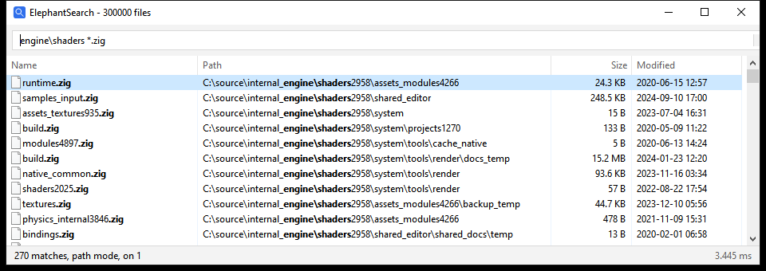

# Searching

Results follow every keystroke. There is no search button.

## Terms

Terms are separated by spaces and all of them have to match. Matching ignores case.

| Term | Matches |
| --- | --- |
| `srcmainzg` | the letters in order with gaps allowed, so it finds `src\main.zig` |
| `"readme"` | the same letters with no gaps |
| `*.zig` | a wildcard pattern with `*` and `?`, so it finds names that end in `.zig` |
| `src\main` | the whole path instead of just the name, for any term with a `\` or `/` |

The tightest match ranks first, so a file called `zig.exe` comes above one that just holds those letters in that order.

A query starts out matching names. When names barely match anything, it matches full paths instead, which is how `srcmainzg` reaches across three directories.

The window bolds what matched, so you can see why a result is there.

## Keys

| Key | Does |
| --- | --- |
| up, down, page up, page down | move through the results |
| enter | open the selected file |
| shift+enter | show it in Explorer |
| ctrl+c | copy its full path |
| esc | clear the query, or quit once it's already empty |
| ctrl+q | quit |

## Commands

A colon starts a command. No file name can hold a colon, so nothing you might search for is out of reach.

| Command | Does |
| --- | --- |
| `:in C:\Users` | search only under that folder |
| `:in` | search every drive again |
| `:exact`, `:fuzzy` | switch how plain terms match |
| `:help` | show the syntax and the keys |
| `:quit` | quit |

From the command line, `--under DIR` does the same as `:in` and `--exact` the same as `:exact`.
